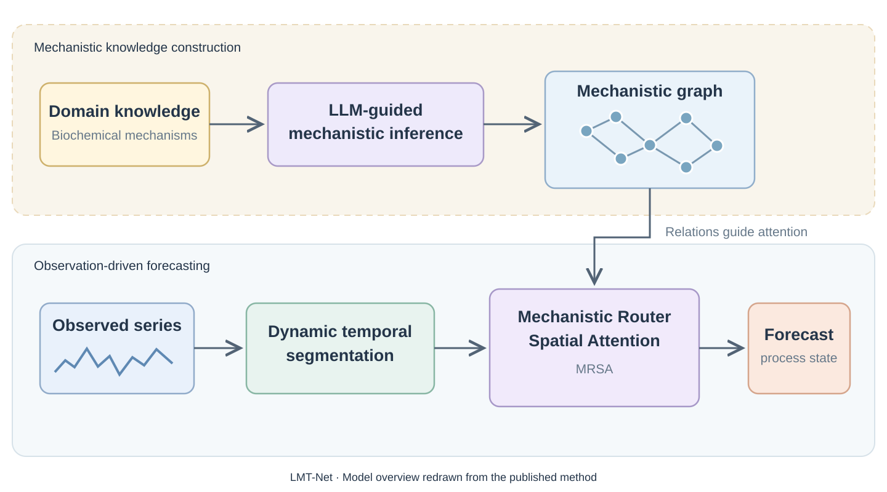

# LMT-Net

**LMT-Net: A Hybrid Forecasting Framework with LLM-Guided Mechanistic Router Spatial Attention for Biochemical Industry Process**

Advanced Engineering Informatics · 2026

[Project page](https://joss0623.github.io/projects/lmt-net/) · [Research homepage](https://joss0623.github.io/)

[Paper](https://doi.org/10.1016/j.aei.2026.105001)

[Publisher / DOI](https://doi.org/10.1016/j.aei.2026.105001) · [BibTeX](https://joss0623.github.io/citations/lmt-net.bib)

## Overview

Use a language model to construct mechanistic relations and guide spatial attention for biochemical process forecasting.

## Model overview

Model overview redrawn from the published method.

## Research focus

- Mechanistic relations
- Router spatial attention
- LLM-guided forecasting

## Resources

This repository currently provides the project description and available publication links. A matching standalone code release has not yet been identified in the maintained source collection.
